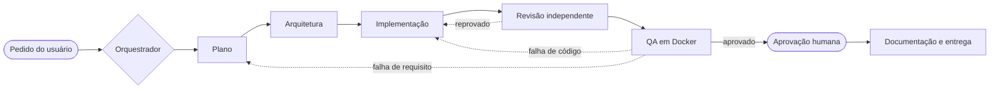
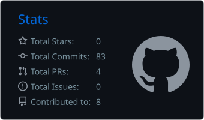
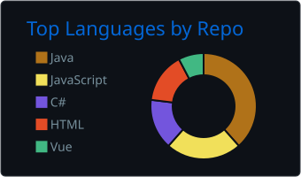
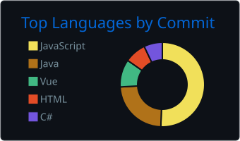
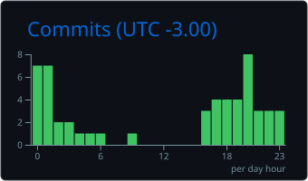

  

---

## 🧭 Sobre

Sou desenvolvedor Full Stack e me formei em dezembro de 2026. Em paralelo à faculdade, construí propostas de projetos, entre eles SaaS e sistemas completos de ponta a ponta: modelagem de dados, back-end, interface e entrega.

Trabalho de forma autônoma desde antes da graduação, atendendo clientes reais. Isso me ensinou a lidar com o prazo, a entender o problema do cliente antes de escrever o código e entregar o que foi combinado.

## ⚡ Destaques

<table>
<tr>
<td width="25%" align="center"><h3>🗂️ 16</h3>repositórios públicos, entre projetos pessoais e acadêmicos</td>
<td width="25%" align="center"><h3>🧩 SaaS</h3>sistemas completos, do banco ao front</td>
<td width="25%" align="center"><h3>🤖 Ophiuchus</h3>fábrica de software com agentes de IA</td>
</tr>
</table>

---

## 🛠️ Stack técnica

> Linguagens, bancos de dados e ferramentas que uso nos meus projetos.

**💬 Linguagens**

**⚙️ Back-end e APIs**

**🎨 Front-end**

**🗄️ Bancos de dados**

**☁️ Cloud, DevOps e mensageria**

**🤖 Inteligência Artificial**

---

## 🚀 Projetos em destaque

### 🐍 Ophiuchus · Agentic Engineering Workspace

> **Fábrica de software com agentes de IA.** Um console de engenharia para **orquestração visual**, **rastreamento determinístico de estado** e **validação com humano no controle** (human-in-the-loop).

Vários agentes de IA, cada um com uma função, trabalham em sequência sobre o mesmo projeto: **planejam, desenham a arquitetura, implementam, revisam e testam**. Um orquestrador controla o fluxo, e os checkpoints exigem aprovação humana antes de qualquer alteração.

### 🧱 Projetos de engenharia de software

| Projeto | O que demonstra | Stack |
|:--|:--|:--:|
| [🎬 **NetflixAPI**](https://github.com/lukinha21/NetflixAPI-) | Design de API REST, modelagem de entidades e regras de negócio |  |
| [👥 **API_de_Usuarios**](https://github.com/lukinha21/API_de_Usuarios) | CRUD, camadas, validação e gestão de usuários |  |
| [📚 **sistema-biblioteca**](https://github.com/lukinha21/sistema-biblioteca) | Sistema completo com regras de empréstimo e persistência de dados |  |
| [📊 **ordenacao-po**](https://github.com/lukinha21/ordenacao-po) | Algoritmos de pesquisa e ordenação, análise de desempenho |  |
| [🎞️ **PO_animacao**](https://github.com/lukinha21/PO_animacao) | Visualização de algoritmos e programação orientada a objetos |  |
| [🍻 **Calculadora_de_Buteco**](https://github.com/lukinha21/Calculadora_de_Buteco) | Lógica de negócio aplicada com interface web |  |

---

## 📊 Métricas do GitHub

  

<picture>
  <source media="(prefers-color-scheme: dark)" srcset="https://raw.githubusercontent.com/lukinha21/lukinha21/output/github-contribution-grid-snake-dark.svg" />
  <source media="(prefers-color-scheme: light)" srcset="https://raw.githubusercontent.com/lukinha21/lukinha21/output/github-contribution-grid-snake.svg" />
  
</picture>

